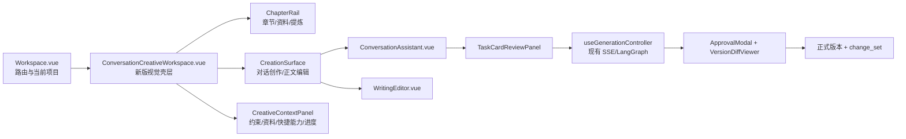

# 对话式创作前端改造映射

> 目标：升级现有章节工作台的视觉和交互，让“对话创作”成为主工作区；兼容性通过 store、API 和执行控制器实现，而不是继续照搬旧版三栏样式。

## 1. 原型对应的现有页面

原型文件：

- [章节工作台对话助手原型](../output/conversation-creative-studio-prototype.html)

原型采用新版视觉，但每个区域都对应现有能力：

| 原型区域 | 现有代码位置 | 改造原则 |
| --- | --- | --- |
| 顶部项目栏、资料库、评测集、导出 | `frontend/src/views/Workspace.vue` 的 `.top-bar` | 保留动作和路由，重做视觉层级、间距与品牌样式 |
| 左侧现代章节栏、`资料`、`提炼` | `Workspace.vue` + `useChapterStore` | 继续使用现有章节选择和提炼接口，组件视觉重新设计 |
| 中间“对话创作 / 正文编辑”主画布 | 新增 `ConversationCreativeWorkspace.vue`，内部复用 `ConversationAssistant.vue` 和 `WritingEditor.vue` | 对话成为默认工作面；正文编辑器仍是正式正文唯一编辑入口 |
| 右侧任务上下文、快捷能力、执行链路 | 新增 `CreativeContextPanel.vue`，复用 `AgentPanel.vue` 当前的数据和动作 | `章节生成/润色/转折建议/读者视角` 接口全部保留，但以新版上下文栏呈现 |
| 任务卡确认 | `TaskCardReviewPanel` / `AgentPanel.vue` | 继续作为执行前人工确认点；聊天层只负责把自然语言整理成任务卡 |
| 候选稿双栏对照、丢弃、继续调整、采用 | `ApprovalModal.vue` + `VersionDiffViewer.vue` | 不新建第二套对照页，直接复用现有人工审核弹窗 |
| 版本和 AI 生成历史 | `useChapterVersionStore` / `useGenerationHistoryStore` | 对话产生的候选稿沿用 `generation_records.status=candidate` |

## 2. 推荐的页面形态

新版采用“对话主画布 + 正文编辑切换 + 右侧任务上下文”：



核心体验是：

1. 用户进入章节后默认看到新版对话创作主画布；
2. 用户直接输入“压缩前半段、保留伏笔、不要改人物关系”；
3. AI 先返回意图和任务卡，不立即调用生成流程；
4. 用户确认任务卡后，复用现有章节生成/润色工作流；
5. 结果进入现有人工审核双栏对照；
6. 用户点击“采用并生成新版本”后，服务端完成版本冲突检查并写入正式版本，前端刷新正文和版本历史；
7. 用户随时可以切换到“正文编辑”，继续使用现有编辑器手动修改。

这能解决当前“操作入口很多但不好调整”的问题，同时保留你已经做好的事务、版本、审核和回滚能力。

## 3. 前端组件拆分

### 3.1 `Workspace.vue`：只做路由和工作对象

不把对话或生成业务逻辑继续堆进 `Workspace.vue`。它只向新版壳层传递当前工作对象：

```ts
{
  projectId,
  mode,
  chapterId,
  chapterNum,
  chapterTitle,
  currentVersionId,
  currentDraft,
}
```

现有 `currentWritingUnit`、`projectId`、`projectMode` 已经可以提供大部分信息。正文内容和版本号应由已有 store/API 读取，不通过 DOM 反查。

### 3.2 新增 `ConversationCreativeWorkspace.vue`：承载新版样式

该组件只负责视觉布局和模式切换：

- 左侧 `ChapterRail`：章节、资料、提炼；
- 中间 `CreationSurface`：`对话创作` / `正文编辑`；
- 右侧 `CreativeContextPanel`：任务对象、锁定约束、资料来源、快捷能力和执行进度。

视觉层可以彻底升级，但不能复制现有业务逻辑。`AgentPanel.vue` 当前承担的这些能力要下沉为可复用控制器：

- `generateStream` 和 SSE 看门狗；
- `clarification_required` / `task_card_review_required`；
- `ApprovalModal`；
- 生成失败、取消、重试、定稿和人工审核闭环。

建议抽取：

```vue
const generation = useGenerationController(projectId)

// 新旧视觉都调用同一个 controller
generation.startTask(taskCard)
generation.resumeHumanReview(action)
generation.cancel()
```

### 3.3 `ConversationAssistant.vue`：对话主画布

这个组件不直接操作数据库，也不直接调用章节生成 API。它负责：

- 展示消息；
- 展示识别出的意图；
- 展示任务卡和澄清问题；
- 触发 `send`、`confirm`、`revise`、`cancel` 事件；
- 展示版本冲突和请求失败。

它在新版中是中间主画布，但仍然只调用 `useConversationStore` 和 `useGenerationController`，不直接写数据库。

### 3.4 新增 `CreativeContextPanel.vue`：兼容现有快捷能力

右侧新版上下文栏不是装饰区域，它要映射现有功能：

- `章节生成` → 现有 `handleGenerate`；
- `润色` → 现有 enhance 流程；
- `转折建议` → 现有 turn suggestions；
- `读者视角` → 现有 summarize 流程；
- `工作流进度` → 现有 `AgentWorkflow` 状态；
- 已加载角色/事件/暗线/设定 → 现有 `contextStats`。

这就是“接口兼容”的位置：按钮和视觉变了，调用的 store、API、SSE 事件和审核状态不变。

### 3.5 复用已有审核组件

对话生成候选后不另写一个“聊天结果预览”：

- 候选稿：继续使用 `generationHistoryStore`；
- 修改前/修改后：继续使用 `ApprovalModal` 和 `VersionDiffViewer`；
- 采用：调用候选采用接口，服务端确认 `base_version_id` 后写新版本，前端重新加载正文和版本历史；
- 丢弃：沿用 generation record 的 `discarded`；
- 冲突：在审核弹窗顶部增加 `version_conflict` 提示和“基于最新版本重新生成”。

## 4. 状态应该放在哪里

新增一个 `useConversationStore`，不要把聊天消息塞进 `useExpertStore`。两者职责不同：

| 状态 | 所属 | 说明 |
| --- | --- | --- |
| 当前项目、当前章节、正文 | 现有 `project/chapter/document` store | 页面事实来源 |
| 生成中、SSE、工作流节点、审核弹窗 | 现有 `expertStore` + `AgentPanel` | 章节生成执行状态 |
| 会话 ID、消息、摘要、任务卡、澄清问题 | `useConversationStore` | 对话状态 |
| candidate generation record | `useGenerationHistoryStore` | 候选稿事实来源 |
| 版本冲突、幂等号、请求错误 | `useConversationStore` 的 request state | 不写入正文 |

建议的前端状态：

```ts
type ConversationState = {
  sessionId: string | null
  messages: ChatMessage[]
  intent: IntentResult | null
  taskCard: TaskCard | null
  awaiting: 'idle' | 'clarification' | 'task_card_confirm' | 'candidate_review'
  candidate: GenerationRecord | null
  baseVersionId: string | null
  idempotencyKey: string | null
  versionConflict: { latestVersionId: string } | null
  sending: boolean
  error: string | null
}
```

其中 `baseVersionId` 必须在发送确认时从当前正式版本读取并回显，不能从上一次聊天消息里猜。

## 5. API 与现有前端的映射

建议在 `frontend/src/api/client.ts` 追加接口，在 `frontend/src/api/types.ts` 追加类型：

| 交互 | 前端入口 | 后端契约 | 成功后的前端动作 |
| --- | --- | --- | --- |
| 发送自然语言 | `ConversationAssistant` | `POST /chat/sessions/{id}/messages` | 写入消息，展示意图/任务卡，不生成 |
| 确认任务卡 | `useGenerationController` | `POST /chat/sessions/{sid}/messages/{mid}/confirm` | 传当前章节上下文、`base_version_id` 和本次操作幂等号 |
| 生成候选 | `useGenerationController` | 统一的现有生成执行入口 | 更新 `expertStore`，等待候选稿，禁止再建第二套一次性生成逻辑 |
| 打开对照 | `CreationSurface` | 现有生成记录接口 | 加载 `generation_records`，打开 `ApprovalModal` |
| 采用候选 | `ApprovalModal` 回调 | `POST /chat/executions/{id}/candidate/accept` | 服务端检查版本冲突并写新版本，前端刷新正文与版本历史 |
| 继续调整 | `ConversationAssistant` | `candidate/revise` | 保留当前候选和任务卡，追加用户修改要求 |
| 丢弃候选 | 现有审核回调 | `candidate/discard` | 标记 candidate 为 discarded |
| 撤销本轮 | 新增会话操作 | `change-sets/{id}/revert` | 成功后刷新章节/版本历史 |

错误不能只弹“服务器异常”：

- `409 version_conflict`：审核弹窗显示“正文已在其他操作中更新”，提供“基于最新版本重新生成”；
- `clarification_required`：在任务卡内嵌问题，不离开当前章节；
- `idempotency_duplicate`：恢复第一次请求的结果，不重复追加消息或生成候选；
- `intent_unsupported`：明确告诉用户当前不支持什么，而不是默认为改写。

## 6. 分阶段改造顺序

### 阶段一：建立新版视觉壳和兼容控制器

- 新增 `ConversationCreativeWorkspace.vue`、`ChapterRail.vue`、`CreationSurface.vue`、`CreativeContextPanel.vue`；
- 从 `AgentPanel.vue` 抽取 `useGenerationController`，让新旧视觉调用同一执行逻辑；
- 中间默认展示 `ConversationAssistant.vue`，可切换到原有 `WritingEditor.vue`；
- 右侧新版按钮复用章节生成、润色、转折建议、读者视角和工作流状态；
- fixture/mock 只允许存在于原型和组件测试，真实应用不得在接口错误时静默回退 mock。

验收：新版页面视觉与原型一致；所有旧能力都能从新版入口触发，并且调用的是同一 store/API/controller。

### 阶段二：接消息契约

- 新增 `useConversationStore`；
- 接入 messages / confirm；
- 服务端返回任务卡后，前端只展示和确认，不直接拼 prompt；
- 消息流使用已有 SSE 基础设施，统一取消、超时、重试提示。

验收：同一 `idempotency_key` 重试不会出现两条相同任务或两个候选稿。

### 阶段三：接候选稿和版本保护

- confirm 生成的结果写入现有 `generationHistoryStore`；
- 打开既有 `ApprovalModal` 双栏对照；
- 采用前校验 `base_version_id`；
- 解决 `version_conflict`、discard、revise；
- 采用成功后由服务端生成正式版本，前端重新加载章节正文、版本历史和 AI 生成历史；
- 手动编辑仍然使用 `WritingEditor.vue` 的现有“保存”按钮。

验收：用户在对话生成期间手动修改正文，旧候选不能覆盖手动修改。

### 阶段四：再做体验增强

- 会话摘要和已确认约束的折叠展示；
- 最近操作和“撤销本轮”；
- 对话消息引用当前章节、版本和检索证据；
- 移动端复用新版的“章节 / 对话 / 正文 / 上下文”底部切换，不维护第二套业务逻辑。

## 7. 明确不做的事

- 不把项目首页改成无章节上下文的通用聊天页；对话创作只在选中章节后成为主工作面；
- 不让聊天组件直接修改 `WritingEditor` 的正式正文；
- 不在聊天组件里复制一份章节生成状态机；
- 不把全部项目资料和全部历史消息默认塞给模型；
- 不用一个“AI 已完成”文案代替任务卡、候选稿和人工审核状态。

## 8. 原型验收重点

查看原型时重点看四件事：

1. 左侧是升级后的章节栏，`资料` / `提炼` 接口仍然存在；
2. 中间默认是漂亮的对话创作主画布，一键切回原有正文编辑能力；
3. 右侧以新版样式展示当前任务上下文，同时保留章节生成、润色、转折建议、读者视角和工作流进度；
4. 点击“确认并生成候选稿”后进入人工审核双栏对照；
5. 点击“采用并生成新版本”后，版本冲突检查、正式版本写入和前端刷新语义一致。
