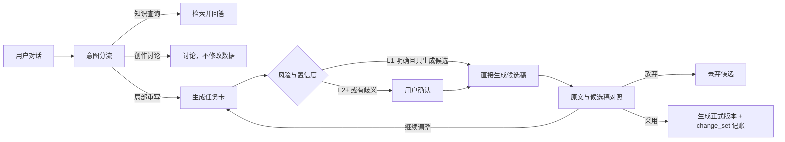

# 对话式创作方案 v2（设计稿，未实现）

> 状态：设计文档，五决策已拍板，后端契约草案待确认。未开始实现。
> 定位：以对话为入口、以结构化任务卡为执行契约、以多 Agent 工作流为执行引擎、以人工确认为最终决策的小说创作助手。
> 前置：P-1 章节编号修复已激活（新代 3eb7176c active，3116 章，legacy 保留）。本方案不推翻 LangGraph/版本/审核/记忆/事务机制，只在其上加对话层。

---

## 1. 目标与分层

```
对话层     → 理解意图、维护会话、生成任务卡（不直接改库）
意图层     → 意图分流 + 执行计划 + 风险分级
执行层     → 调用现有工作流（编辑/审核/一致性检查/版本/记忆）
存储层     → 正式数据 + change_set 操作记账 + 会话/记忆分层存储
```

核心约束：
- **聊天内容不直接写正式数据**；AI 先产出"拟执行操作"（任务卡），确认后执行。
- 所有输出先成为**候选版本**；只有"采用/定稿"才写正式数据；每次修改可回退。
- 数据事实唯一来源是数据库，AI 不得声称修改但实际未落库（执行后必须落库并回读验证）。

---

## 2. 意图分流与执行计划

### 2.1 五类意图（至少）

| 意图 | 示例 | 执行 |
|---|---|---|
| 知识查询 | "穆白最后出现在哪里？" | 检索并回答（走账本优先链路：3195，不得答 3092） |
| 创作讨论 | "这一章是不是节奏太慢？" | 直接回答，不生成任务、不修改数据 |
| 修改指令 | "压缩这一章的前半段。" | 生成任务卡 → 按风险分级执行 |
| 数据操作 | "把人物名字统一改成程璇。" | 跨对象变更 → 任务卡 + 必须确认 |
| 流程控制 | "撤销刚才修改""采用这一版""定稿" | 映射到 change_set / 版本操作 |

### 2.2 复合任务 → 执行计划

不能只做单标签分类。用户可能说：

> "查一下穆白最后的状态，然后按照这个状态修改第十章。"

这是"先查询、再创作"的多步骤任务。输出**结构化执行计划**（JSON）：

```json
{
  "plan_id": "...",
  "steps": [
    {"intent": "knowledge_query", "target": "穆白最后状态", "query": "穆白 结局 最后出现"},
    {"intent": "rewrite", "target": {"chapter_no": 10}, "based_on": "步骤1结果"}
  ],
  "dependencies": [{"step": 2, "depends_on": [1]}]
}
```

计划对用户回显确认（风险分级决定确认深度）；每步独立可重跑。

---

## 3. 风险分级（不每次都强制确认）

| 级别 | 动作 | 确认要求 |
|---|---|---|
| L0 | 只读查询 / 创作讨论 | 直接执行/回答，不生成任务 |
| L1 | 产生候选稿（不覆盖正文） | 直接执行，进入候选对照区 |
| L2 | 修改单章正式内容 | 任务卡确认 |
| L3 | 修改大纲、人物设定、多章节 | 必须确认 |
| L4 | 删除、覆盖、定稿 | 二次确认（明确提示影响范围） |

**澄清触发条件**（任一命中必须反问，不得猜测）：
- 置信度低（如"第五章"是序号还是标题）；
- 目标不明确（操作对象缺失/歧义）；
- 约束冲突（"压缩到一半"但"不要删伏笔"逻辑冲突）；
- 跨对象影响不明确。

规则：**宁可多问一步，不要推断执行**（与 RAG/账本修复同一原则）。

---

## 4. 上下文分层（不用 writing_memory_staging 承担聊天上下文）

`writing_memory_staging` 定位修正：只保存"从章节提炼、等待用户确认的创作事实"。
聊天记录单独分层：

| 层 | 内容 | 存储/来源 |
|---|---|---|
| 短期上下文 | 最近 N 轮原始对话 | chat_messages 表 |
| 会话摘要 | 压缩的历史讨论 | chat_sessions.summary（LLM 生成，定期刷新） |
| 已确认任务约束 | "不能删除伏笔" | task_constraints 表（确认后固化） |
| 项目长期记忆 | 人物/世界观/事件/定稿章节 | 现有结构化表（账本激活后 display 编号正确） |
| 任务检索结果 | 按需加载 | 执行时检索，不长期塞入提示词 |

**提示词装载规则**（每次执行只装当前任务真正需要的字段）：

```
固定上下文
├── 项目与章节 ID
├── 已确认人物和世界观
└── 当前正式版本（ChapterVersion 快照）

任务上下文
├── 当前任务卡
├── 必须保留/禁止修改项（task_constraints）
├── 检索证据
└── 修改前版本

会话上下文
├── 最近若干轮原文
└── 历史会话摘要
```

---

## 5. change_set 操作记账（跨对象撤销的关键）

"撤销刚才修改"必须能撤跨对象修改（正文+大纲标题+人物设定）。单纯依赖章节版本不够。

新表 `change_sets`：

```sql
change_sets:
  id UUID PK
  session_id UUID          -- 所属会话
  operation_type TEXT      -- rewrite / rename / delete / finalize ...
  intent TEXT              -- 意图分类
  status TEXT              -- pending / applied / reverted / failed
  objects JSON             -- [{object_kind: chapter/outline/character,
                               object_id, before_ref, after_ref}, ...]
  parent_change_set_id     -- 关联（撤销整轮 = 按序回滚 change_set 链）
  created_at, applied_at, reverted_at
```

- **应用**：执行工作流 → 记录每个受影响对象的前/后引用（章节版本 id、大纲行 id、人物行 id）→ change_set 置 applied。
- **撤销粒度**：
  - 撤销最近一版候选稿 → 丢弃候选（未写正式数据，无需记账）；
  - 恢复到某章节版本 → 复用 `rollback_from_version_id`；
  - 撤销本轮所有操作 → 按时间序逆序回滚 change_set 链；
  - 撤销跨对象修改 → 遍历 objects 逐对象恢复 before_ref。
- **流程控制意图**（"撤销""采用""定稿"）映射到 change_set 状态流转，不新增平行机制。

---

## 6. 局部重写闭环（第一步，最小闭环）



第一步只做"单章局部重写"一种操作类型，跑通全链路后再扩展。

---

## 7. 数据模型与迁移草案

新增表（不碰现有表结构）：
- `chat_sessions`（id, project_id, user_id, title, summary, created_at, updated_at）
- `chat_messages`（id, session_id, role, content, intent, plan_id, task_card JSON, created_at）
- `change_sets`（见 §5）
- `task_constraints`（id, session_id, content, source_message_id, status, created_at）
- 候选稿可落 `generation_records`（现有表，status=proposed 区分正式）或独立 `candidate_drafts`（评审后定）

迁移方式：与 P-1 同一套 alembic + 桌面端增量迁移（create_all + ADD COLUMN 兼容），副本验证后上线。

---

## 8. 与现有系统对接点

| 现有能力 | 对接 |
|---|---|
| ChapterVersion / rollback_from_version_id | 撤销到版本、定稿快照 |
| review_notes | 审核意见进任务上下文、审核问题可"接受/忽略" |
| writing_memory_staging | 只用于"提炼待确认事实"，确认后并入长期记忆 |
| 结构化知识（账本激活） | 知识查询意图走账本优先链路（穆白→3195） |
| LLM 配置 / provider | 对话层沿用现有 provider 解析与 mock 隔离 |

---

## 9. 度量与验收

| 指标 | 采集点 | 目标方向 |
|---|---|---|
| 任务卡被纠正比例 | 确认步骤 | 下降（分流质量提升） |
| 候选稿直接采用率 | 采用按钮 | 上升 |
| 平均完成一次修改轮数 | session 内步数 | 下降 |
| 错章节/错对象修改次数 | change_set.objects vs 用户确认 | 趋零 |
| 采用后用户再次手改幅度 | 版本 diff | 下降 |
| 平均 Token 与耗时 | 每次执行记录 | 可观测即可 |
| 撤销率与失败率 | change_sets.status | 可观测即可 |

采集方式：任务卡生成点、采用点、change_set 应用点埋点；输出到现有日志体系。

---

## 10. 不做的事

- 不推翻现有工作流/版本/审核/记忆/事务机制；
- 不把聊天内容直接写正式数据；
- 不用 writing_memory_staging 承担聊天上下文；
- 不做"纯聊天"（无任务卡、无确认、无版本）；
- 第一步只做局部重写闭环，不同时铺全部操作类型；
- 对话层上线不改变现有固定入口功能（保留，折叠高级参数）。

---

## 11. 待拍板决策点（已全部拍板）

1. **候选稿存储**：✅ 复用 `generation_records`（保留现有 `candidate` 状态；后续按需增 `conversation_id`/`base_version_id`/`task_card_id` 字段，不新建 candidate_drafts 表，避免两套候选稿生命周期）。
2. **change_set 首步范围**：✅ 只做**单对象（章节正文）**。`objects` 字段按数组设计，预留跨对象（正文+大纲+人物），第一版不做跨对象（回滚/冲突/事务边界复杂）。
3. **UI 形态**：✅ 先定后端契约，再做界面。前端第一版嵌入现有章节页面（左章节/中正文/右对话助手），不替换整个工作台。
4. **会话持久化**：✅ 双后端——桌面端 SQLite + 服务端 PostgreSQL 同步支持（模型与迁移同时兼容）。会话消息追加写入不覆盖；摘要与已确认约束单独保存；聊天原文不永久注入提示词。
5. **上线节奏**：✅ 沿用副本开发 → 单文件测试 → 副本端到端 → 重建桌面包 → 启动新包验证 → 生产库备份 → 生产灰度 → 用户验收。第一版不直接改动正式章节，只生成候选稿；"采用/定稿"才进现有版本与事务链路。

### 强制字段（新增，必须实现）

- **`base_version_id`**：候选稿必须记录它基于哪个正式版本。提交时重查 `当前版本 == base_version_id`，不一致则提示"当前章节已被修改，是否基于最新版本重新生成？"——避免 AI 用旧正文覆盖用户手动修改。
- **操作幂等号（`idempotency_key`）**：每次对话操作分配唯一号；重复提交/网络重试只执行一次，防止重复落库或重复生成。

---

## 12. 后端契约草案（第一版：对话式局部重写）

### 12.1 会话

- `POST /api/chat/sessions`（project_id）→ 创建/取会话，返回 `session_id`
- `GET /api/chat/sessions/{id}` → 会话元数据 + 摘要
- `POST /api/chat/sessions/{id}/summary/refresh` → 刷新压缩摘要

### 12.2 消息与意图

- `POST /api/chat/sessions/{id}/messages`：发送用户消息
  - 请求：`{content, session_id, idempotency_key}`
  - 响应（**先回意图，不直接执行**）：
    ```json
    {
      "message_id": "...",
      "intent": "knowledge_query | discussion | rewrite | data_operation | flow_control",
      "plan": {"steps": [...], "dependencies": [...]},   // 复合任务才非空
      "requires_confirmation": false,
      "task_card": {...} | null
    }
    ```
- `POST /api/chat/sessions/{id}/messages/{message_id}/confirm`：确认任务卡 → 执行
  - 请求：`{confirmed: true, overrides: {...}}`（可覆盖任务卡字段）
  - 响应：`{execution_id, status, candidate: {...}, change_set: {...}}`
- `POST /api/chat/messages/{message_id}/clarify`：澄清后重新识别（走 `depends_on` 步骤）

### 12.3 任务卡（rewrite 示例）

```json
{
  "schema_version": 1,
  "operation_type": "chapter_rewrite",
  "target": {"chapter_no": 5, "version_id": "章节当前版本"},
  "base_version_id": "候选稿基于的正式版本",
  "constraints": {
    "must_preserve": ["结尾伏笔"],
    "must_not_change": ["人物设定", "大纲"],
    "target_word_count": 3000
  },
  "risk_level": "L2",
  "confirmation_required": true,
  "idempotency_key": "..."   // 复用请求方幂等号或服务端生成
}
```

### 12.4 候选稿与采用

- `POST /api/chat/executions/{id}/candidate/accept`：采用候选稿
  - 服务端重查 `当前章节版本 == base_version_id`，不一致 → `409 {code: "version_conflict", latest_version_id}`（前端提示重新生成）
  - 一致 → 走现有版本/事务链路，写 change_set，返回 `{change_set_id, new_version_id}`
- `POST /api/chat/executions/{id}/candidate/discard`：丢弃候选稿（不写正式数据）
- `POST /api/chat/executions/{id}/candidate/revise`：继续修改（带 `revise_instruction` → 重新生成候选）

### 12.5 流程控制意图

- `POST /api/chat/change-sets/{id}/revert`：撤销该 change_set（对象恢复 before_ref）
- `POST /api/chat/change-sets/revert-session`：撤销本轮会话所有操作（按时间逆序）
- `POST /api/chat/executions/{id}/finalize`：定稿（走现有定稿链路）

### 12.6 错误语义

| 错误 | 含义 | 处理 |
|---|---|---|
| `version_conflict` | 当前版本 ≠ base_version_id | 409 + latest_version_id，前端提示重新生成 |
| `idempotency_duplicate` | 幂等号重复 | 200 返回首次结果（幂等） |
| `clarification_required` | 置信度低/目标不明/约束冲突 | 200 + 澄清问题，不执行 |
| `intent_unsupported` | 第一版不支持的意图 | 说明能力边界，不猜测执行 |

---

## 13. 数据模型（双后端兼容，草案）

```sql
-- 会话
chat_sessions:
  id UUID PK
  project_id UUID, user_id UUID
  title TEXT, summary TEXT        -- 摘要单独存，不混入原文
  created_at, updated_at

-- 消息（追加写，不覆盖）
chat_messages:
  id UUID PK
  session_id UUID FK
  role TEXT                       -- user / assistant / system
  content TEXT
  intent TEXT NULL                -- 识别结果（assistant 消息）
  plan JSON NULL
  task_card JSON NULL
  execution_id UUID NULL          -- 关联执行
  idempotency_key TEXT            -- 请求幂等号（user 消息唯一）
  created_at
  UNIQUE(session_id, idempotency_key)

-- 已确认任务约束（"不能删除伏笔"）
task_constraints:
  id UUID PK
  session_id UUID FK
  content TEXT
  source_message_id UUID FK
  status TEXT                     -- active / superseded
  created_at

-- 操作记账（跨对象撤销；第一版只记单对象正文，objects 数组预留）
change_sets:
  id UUID PK
  session_id UUID FK
  execution_id UUID
  operation_type TEXT             -- chapter_rewrite
  intent TEXT
  status TEXT                     -- applied / reverted / failed
  objects JSON                    -- [{object_kind, object_id, before_ref, after_ref}]
  base_version_id UUID NULL
  parent_change_set_id UUID NULL
  created_at, applied_at, reverted_at

-- generation_records 复用（现有表，候选稿不新增表）
-- 后续按需 ADD COLUMN：conversation_id / base_version_id / task_card_id
```

迁移方式：alembic + 桌面端增量迁移（与 P-1 同一套，create_all + ADD COLUMN 兼容），PG/SQLite 双后端同构。

---

## 14. 实现约束（v2 批准时锁定，开工必须遵守）

1. **`base_version_id` 指向正式版本**：必须指向章节的正式版本（ChapterVersion），不得指向候选稿或生成任务。候选稿存 generation_records 时只记录其基于的正式版本 id。
2. **`idempotency_key` 唯一范围**：`用户 + 项目 + 接口` 三元组内唯一；**保存首次响应结果**，重复请求直接返回首次结果，不重新生成。
3. **确认/执行操作全幂等**：`confirm / accept / discard / revert` 重复调用返回当前状态，不重复生成、不重复回滚、不重复写版本。
4. **change_set 与版本写入同事务**：正式提交时，change_set 落库必须与版本写入处于**同一个事务**——正文/版本已保存但操作账本未记录的情况禁止出现；任一侧失败整体回滚。

### 开工顺序（第一阶段：单章节局部重写）

```text
1. chat_sessions / chat_messages（模型 + 迁移，双后端）
2. change_sets（模型 + 迁移 + 同事务提交）
3. 对话意图分流（五类 + 复合计划 + 风险分级）
4. 任务卡确认（clarify / confirm，幂等）
5. 局部重写候选稿（base_version_id + idempotency_key）
6. 原文/候选稿对照
7. 采用与版本冲突检测（当前版本 == base_version_id，409 version_conflict）
8. 撤销与幂等测试（revert / revert-session / 幂等断言）
```

第一阶段只做单章节局部重写，**不接**大纲、人物关系、多章节联动。开发流程：副本开发 → 单文件测试 → 副本端到端 → 重建桌面包 → 启动新包验证 → 生产库备份 → 生产灰度 → 用户验收。
